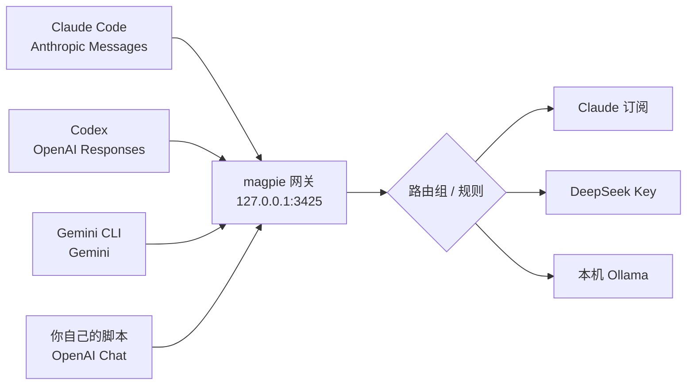

# Magpie 进阶用法：用一个本地网关接管所有 AI Agent 的模型

先说个容易搞混的事。

我一开始听到 Magpie 这个名字，以为又是个截图 OCR 的小工具。搜出来才发现，叫 Magpie 的东西至少有三个，一个 Windows 上的超分工具，一个 macOS 上的划词助手，还有一个是 yetone 写的、跑在本机的 AI 网关。这篇文章说的是最后那个，官网 [usemagpie.ai](https://usemagpie.ai/zh/)，仓库 [yetone/magpie](https://github.com/yetone/magpie)。

它没有截图、录屏、OCR、翻译这些功能，一行都没有。

它只做一件事，把你电脑上所有 AI Agent 用的模型，收回到一个地方管。

## 它到底在干什么

现在的情况是，Claude Code 的模型写在 `~/.claude/settings.json` 里，Codex 写在 `~/.codex/config.toml` 里，Gemini CLI 又是一套 `~/.gemini/.env`。格式不同，key 不同，base URL 不同。你花两百美金买的 Claude 订阅，只能在 Claude Code 里用。

Magpie 插在中间，做了两件事（官网首页、GitHub README）。

第一件，在本机 `127.0.0.1:3425` 起一个网关。这个网关同时听得懂 OpenAI Chat Completions、OpenAI Responses、Anthropic Messages、Gemini 四套协议，并且能在它们之间互转，流式输出、工具调用、推理过程都保留。所以 Codex 可以用 DeepSeek，Claude Code 可以用 Kimi，Gemini CLI 可以用 GLM。

第二件，替你改配置文件。你在界面里点一个模型，它只改那个 Agent 配置里必需的那几个键，注释、顺序、缩进原样留着，写入是原子的。选回 Agent 自带的模型，它会把之前写进去的东西删掉，还原你原来的值。



判断要不要装，README 自己给了标准。**用不止一个 Agent、不止一个供应商、或者不止一个账号，就适合。只用一个 Agent 用官方订阅而且够用，就不需要。** 这句话挺实在的，省了很多人装完再卸的时间。

## 安装，和国内网络那个坑

桌面版去官网下，Mac 版有签名公证，每个版本自动更新。终端党一行。

```bash
curl -fsSL https://usemagpie.ai/install.sh | sh
```

Linux 上脚本会自己判断，有桌面环境就装桌面版，缺 WebKitGTK 4.1 会调包管理器先补上，要 sudo 密码。没桌面就装终端版。想强制选一种，加 `--gui` 或 `--tui`。

国内网络是第一个坑，因为安装和更新都要访问 GitHub。官方给了两个参数，`--proxy` 和 `--mirror`。

```bash
# 安装时走本地代理
curl -fsSL https://usemagpie.ai/install.sh | sh -s -- --proxy http://127.0.0.1:7890

# 更新时走代理
magpie update --proxy socks5://127.0.0.1:1080

# 之后每次更新都走某个下载镜像
magpie update mirror <前缀>
magpie update mirror off
```

镜像这块有个细节值得说，它只负责下文件，SHA-256 始终从 usemagpie.ai 取，镜像改过的包会被拒绝安装（掘金那篇实战教程里贴了官方说明）。所以用镜像不等于把信任交出去。

卸载也别用 `rm -rf`。官方脚本的 `--uninstall` 会先把每个 Agent 的配置还原，再删自己装的东西，而 `~/.config/magpie` 里的设置会保留，除非你加 `--purge`。

## 主线三步，外加一个必须记住的坑

流程就三步，加供应商、给 Agent 选模型、开新会话（官网 START）。

```bash
magpie provider add deepseek sk-xxxx        # 预设只要 key
magpie provider add moonshot-cn sk-xxxx     # Kimi 国内版要带 -cn
magpie claude deepseek/deepseek-v4-pro      # Claude Code 换模型
magpie codex moonshot/kimi-k2.5             # Codex 换模型
```

供应商分四类。厂商预设，粘贴 key 就行，`magpie presets` 能列出全部。订阅，点卡片在浏览器里登官方登录页，不用 key，登完就是一个 provider，模型写作 `claude/…`、`codex/…`、`copilot/…`，于是你的 ChatGPT 订阅可以给 Claude Code 用。本机模型，Ollama 和 LM Studio，不用 key。自定义，任意 OpenAI 兼容地址（以 `/v1` 结尾）或 Anthropic 兼容地址（根地址，也就是你平时填给 `ANTHROPIC_BASE_URL` 的那个），中转站基本都走这里。

**坑在这里。运行中的会话不会换模型。** Agent 启动时读配置，所以改完必须开新会话。Codex 还要额外一步，它在启动时生成模型列表，切换后要重启 Codex 应用，再开 `codex` 会话。我第一次看到这条的时候觉得挺反直觉，因为界面上点完就有反馈，很容易以为已经生效了。

还有一个更隐蔽的坑，`magpie` 不读你 shell 里的环境变量。你 `export` 的 `ANTHROPIC_API_KEY` 它不认，只认你在它界面里加进去的（官网 START 写得很明确）。

## 进阶一，用方案（Profiles）管住整套配置

真正开始用之后，你会发现配置不是一套。

省钱的时候，Claude Code 走 DeepSeek，Codex 走 Kimi。干活的时候，两边都用自己订阅。断网或者想省钱的时候，全部走本机 Ollama。

方案就是给整套 Agent 设置拍个快照，存成一个名字。

```bash
magpie save cheap
magpie save main
magpie use cheap
magpie profiles        # 列表里正在用的那个带 ✓
```

有个设计我挺喜欢，手动改了任何一个设置，✓ 就会消失，提醒你已经偏离方案了。这比静默覆盖好得多。

## 进阶二，路由组才是它真正的杀器

方案解决手动切，路由组解决自动切。

最简单的用法是 `auto/` 组，不用你建。你加了两个都能提供同名模型的供应商，比如 Claude 订阅和 Copilot 都有 Claude Opus，DeepSeek 官方和 OpenRouter 都有 DeepSeek，Magpie 会自动把它们合成一个 `auto/<model>` 组，名字按各家写法匹配，`deepseek/deepseek-chat` 和 `deepseek-chat` 算同一个。

手动建也不难。

```bash
magpie group add "Opus anywhere" \
  models=claude/claude-opus-5-5,copilot/claude-opus-5.5 \
  routing=smart

magpie claude group/opus-anywhere
```

Claude 额度用完，请求自动落到 Copilot 上，Agent 那边看不到报错。

模式有一串，`smart`、`order`、`drain`、`rotate`、`usage`、`pace`、`weight`、`fast`、`cheap`。挑几个说人话。

| 模式 | 行为 | 什么时候用 |
| --- | --- | --- |
| `smart` 默认 | 有余量的订阅里，额度最先重置的排第一 | 多个订阅账号，不想浪费 |
| `order` | 第一个答不了就下一个 | 主力加备胎 |
| `drain` | 一个用到耗尽再换，且不切回 | 想把某个账号榨干 |
| `pace` | 每周剩余额度除以距重置小时数，比值最高的先用 | 周额度制，少浪费 |
| `weight` | 按权重分摊，Max 账号给 5，Pro 给 1 | 多账号按付费档位分 |
| `cheap` | 当前时段最便宜的先用，仅路由组 | 同一个模型挂在多个供应商上 |

`cheap` 这个模式有个容易被忽略的细节。它会算分时电价。DeepSeek 官方 API 在高峰时段双倍计价，同一个 DeepSeek 模型同时挂在官方和 OpenRouter 上时，它会判断这个小时谁更便宜，再决定发给谁（官网 START 的路由表里有这条）。

**换账号最大的隐性成本是丢 prompt cache。** 这也是我觉得这个项目做得比较细的地方，它有一个 `stays` 参数。

| `stays=` | 行为 |
| --- | --- |
| `auto` 默认 | 一轮之内保持，跨轮在厂商缓存还值得保留时继续留着 |
| `session` | 整个会话都待在这个账号上 |
| `turn` | 只在一轮内保持 |
| `off` | 每个请求重新路由 |
| `strict` | 绝不换号，额度用完直接把错误交给 Agent |

如果你只用 `rotate` 不用 `stays`，每一轮都换账号，缓存全废，省下来的额度可能还不够补缓存的钱。

### 规则，把某一类对话定向投喂

路由组可以挂规则，条件是 token 数、带图片、要求推理、来自哪个 Agent、意图、压缩上下文、时间段、项目目录。每次你发新消息，从上往下检查，第一条命中的规则把它的模型排第一，其他成员排后面做故障转移。

```bash
# 长对话交给大上下文模型
magpie group rule add opus-anywhere use=openrouter/anthropic/claude-opus-5.5 tokens=150k

# /compact 的总结交给便宜模型，主对话不动
magpie group rule add opus-anywhere use=deepseek/deepseek-v4-flash compact

# 这些项目里的对话先发给 Kimi
magpie group rule add opus-anywhere use=kimi/kimi-k2.6 folders=~/oss,"~/My Project"

# 工作日下午这段时间不用 Copilot
magpie group rule add opus-anywhere pause=copilot/claude-opus-5.5 time=14:00-18:00 days=mon-fri

magpie group rule opus-anywhere      # 查看
magpie group rule mv opus-anywhere 3 1
magpie group rule rm opus-anywhere 2
```

`compact` 那条我觉得最划算。Claude Code 的 `/compact`、自动压缩，Codex 和 OpenCode 的压缩请求，它都能认出来，让便宜模型去写总结，主对话继续留在原来的模型和缓存上。上下文压缩这件事本身不需要多聪明，但它的输出会污染后续所有推理，所以这里该用便宜的还是该用强的，得你自己权衡。我倾向于用同厂家的便宜档，减少风格漂移。

两个细节。**规则只在每一轮开始时决定**，Agent 回传工具结果的过程中不会半途换模型，唯一例外是这一轮涨到超过当前模型的上下文。**token 阈值要留余量**，给 200k 的模型设 150k，别设 199k，因为阈值判断本身也占 token。

组还能嵌套，一层一层按自己的规则分配，最多八层，循环包含会被拒绝。

```bash
magpie group set coder models+=group/opus-anywhere
```

## 进阶三，意图路由，小模型替你分活

这个功能我第一次看觉得有点绕，看完 `docs/zh/intent` 才明白它很朴素。

你给每一类任务写一句描述，比如「a quick question」「writing or fixing tests」。每轮你发消息时，Magpie 把带编号的意图列表加上你最新那条消息，发给你指定的一个小模型（classifier），让它回一个数字。Magpie 拿这个数字从上往下匹配规则。

没有向量嵌入，没有关键词表，不需要训练。就是一个模型读了你的话，挑了个编号。

```bash
magpie group rule add coder use=deepseek/deepseek-v4-flash \
  intent="a quick question" classifier=groq/llama-3.1-8b-instant

magpie group rule add coder use=deepseek/deepseek-v4-pro \
  intent="writing or fixing tests"
```

好处是省钱，坏处是多一次分类调用，而且分类器挂了会退回「当作没有这些规则」。官方文档写得很清楚，分类失败、超时、答了别的，都不匹配任何意图，这轮按没有意图规则来路由。

我的看法是，这个功能适合「日常问答 + 重活」混着用的场景。如果你的对话本来八成都是重活，加它只是多付一次分类费。

## 进阶四，把网关当自己的 API 用

这是最少人提、但我觉得最有价值的一层。

网关不只是给 Agent 用的，任何应用都能直接接。你在 Magpie 里有的所有模型，包括订阅、API key、本地模型、路由组，都在 `/v1` 上以各自的 id 提供。

```bash
export OPENAI_BASE_URL=http://127.0.0.1:3425/v1
export OPENAI_API_KEY=magpie
```

端点覆盖得挺全（`docs/zh/integrate`），`/v1/chat/completions`、`/v1/responses`、`/v1/messages`、`/v1beta/models/{model}:generateContent`、`/v1/models`，甚至还模仿 Ollama 的 `/api/version` 和 `/api/tags`，专供那些只认 Ollama 地址的客户端。

有个小设计我建议用上。key 写成 `magpie-<你的应用 id>`，比如 `Authorization: Bearer magpie-acme`，那么每次调用都会在用量、请求记录和按 Agent 匹配的路由规则里被记成 `acme`。不带的话，它按 User-Agent 的第一个词记，SDK 自带的 User-Agent 会被记成那个 SDK，你就在账单里分不清到底是谁在花钱了。

还有两个接口值得知道。同会话请求带上 `X-Magpie-Session`，然后 `GET /v1/magpie/route?session=<id>` 能在第一个 token 之前告诉你，路由组这一轮选了谁、试过哪些后备。`GET /v1/magpie/quotas` 能拿到各个订阅的剩余额度。

推断一句，官方没写。**这套端点很适合给本地的小工具、脚本、甚至是自己的 Agent 做统一出口**，你写一次「取模型列表、发请求」，以后换厂商只改 Magpie 里的配置，代码不用动。不过它是纯本机服务，局域网要开共享、还要配网关密钥，别把它当成能随便暴露的服务。

## 进阶五，MCP 路由和资源库，把重复配置收成一份

如果你同时用 Claude Code 和 Codex，又都在用同一批 MCP 服务器，那你一定体验过改一处忘一处。

Magpie 的资源库让你写一次 instructions、MCP 服务器、skills 和 subagents，它按各自 Agent 的格式写进各自的文件，而且只删自己写进去的部分。

再打开 **MCP 路由**之后，每个 Agent 只拿到一个叫 `magpie` 的服务器，地址是网关上的 `/mcp/magpie/hub/<agent>`，Magpie 再把调用转给资源库里对应的服务器。

```bash
magpie library mcp router on
magpie library mcp router off
```

这个开关默认关闭，要手动开。开了之后有三个实际好处。配置只写一次。命令型服务器（比如 `npx …` 起的那些）在 Magpie 里只跑一份，不是每个 Agent 各起一份，10 分钟没调用会被停掉，下次调用再启动。Cursor、VS Code、Windsurf 或者另一台电脑上的应用，连上 Magpie 就能用整个资源库。

**这里有个必须知道的安全边界。** 命令型服务器是跑在你这台电脑上的，局域网里拿到网关密钥的人都能通过 MCP 路由调用它们，权限就是你在本机上的权限。密钥只给信得过的人。另外 Claude Desktop 这类不支持远程服务器的 Agent，会保留各自的条目，不会走路由。

## 进阶六，隐私脱敏，默认是关的

Agent 会把读到的东西塞进 prompt，`.env`、配置、带 token 的日志，全都在里面。

打开脱敏（设置 → 隐私，**默认关闭**）之后，key、密码、邮箱这类值会在你的电脑上被换成占位符，像 `{{API_KEY_k3v9x2mq}}`，回复里再换回来，流式文本和工具调用参数都会换。值只在内存里，不落盘。规则抓不到的人名、地址、密码，可以再开一个跑在本机 CPU 上的模型，代价是 1.6 GB 的下载。

有几处细节值得记住。

同一个值每次拿到同一个占位符，所以对话、prompt cache、thinking 签名都不会失效。一个值脱敏过一次，后面在哪出现都脱敏。脱敏开着但跑不起来时，请求会被扣住，返回 503，绝不会按原文发出去。**这条是硬保证，也是你排查「为什么请求突然失败」时的第一嫌疑人。**

代价也很明确。模型看到的是占位符，所以「这个 token 为什么被拒绝」这种必须看原值的任务，做不了。官方给的解法是把这类值放进 `Never mask`。规则也会误判，`Insights › 脱敏` 页面能左右对照看每次请求实际发出去的东西，设置里还有个「试一试」可以直接验证一段文本会被变成什么样。

我的判断是，这个功能对「在真实项目里用 Agent」的人是刚需，对只写玩具 demo 的人可以先不开，因为它的调试成本确实存在。

## 进阶七，额度和账单，别等月底才发现

订阅制的痛点不是花钱，是额度在你不知道的时候过期了。

`magpie quota` 直接列出每个 key、每个套餐、每个账号的余额和额度窗口。用量页有 token、缓存读写、推理、调用次数，按 list price 折算成美元或人民币，也能给某个模型设你自己的价格。账单可以按账号、按上游 key 拆，还能 OTLP 导出到你自己的可观测栈。

**Daily warm-up 是我觉得最「老用户」的一个功能。** 它能在你指定的时间，或者上一个账号重置的瞬间，把每个 Claude 和 ChatGPT 账号的 5 小时窗口开起来，避免窗口在你睡觉的时候白白跑掉。这条在官网首页的 Subscriptions 一节，写得很轻，但它是真正的省钱手段。

## 进阶八，中间件，改请求而不改 Agent

插件体系跑 OpenCode 的 provider 插件，也跑 pi 的包。但对我们这种普通用户，更有用的是它把插件当**网关中间件**用，JS 写 `onRequest`、`onEvent`、`onResponse`，能看到每个 Agent 发出去的每一条请求。

现成的中间件基本是照着 New API 那套做的，配置格式都一样。

| 包 | 干什么 |
| --- | --- |
| `param-override` | 改、删、搬、重写请求字段，可加条件，也可直接拒绝 |
| `model-map` | 用另一个名字发同一个模型，回复仍保留你要的名字 |
| `system-prompt` | 给所有请求或某些 Agent、某些模型加系统提示词 |
| `word-guard` | 敏感词过滤，拦下或打码，用户侧和回复侧都管 |
| `think-tags` | 把 `<think>…</think>` 从回复里拿掉，或把 reasoning 塞进去 |

```bash
magpie plugin add @magpie-community/middleware-model-map
magpie plugin options model-map '{"mapping": {"fast": "deepseek/deepseek-chat"}}'
```

写完一小段 JS 就能注册成别名。

```js
// alias.middleware.js，用 magpie plugin add ./alias.middleware.js 装
export function onRequest(body, ctx) {
  if (body.model === "fast") return { ...body, model: "deepseek/deepseek-chat" };
}
```

这意味着你可以让 Claude Code 里那个 `haiku` 档，实际打到任何你想打的模型上，而不用改 Claude Code 的任何配置。也可以给所有 Agent 统一注入一段团队规范。钩子抛异常或者跑太久，请求会保持原样，不会把你的工作流弄断。

## 坑清单，和怎么绕

把散在各处的坑收成一页，这一段是我觉得这篇文章最该被收藏的部分。

- **改完模型不开新会话，等于没改。** Codex 还要重启应用。
- **只有一个账号又没建路由组，额度用完报错会原样透传给 Agent。** 没有后备就没有故障转移，别指望它凭空变出一个账号。
- **Claude 订阅的请求实际是走本机的 `claude` 二进制。** 所以 Claude Code 得装着，别删。
- **Antigravity 的账号可能因为被判定在 Antigravity 之外使用而封禁。** 官网原话建议用「一个你输得起的账号」。这句警告别当没看见。
- **Claude Code 经 Magpie 跑的时候会从 claude.ai 登出。** 因为 `ANTHROPIC_AUTH_TOKEN` 被写成了 key，`/usage` 里的套餐额度、connectors、语音、`/teleport` 都不可用。想保留登录态，把登录方式设成 claude.ai 登录，Magpie 会写空 token，Claude Code 把自己的凭据发给它，而它不会转发给别的厂商。这条出自掘金那篇实战教程对官方 reference 的转述，我按「社区转述」看待。
- **网关只在 Magpie 活着的时候存在。** 桌面版、`magpie serve`、`magpie web`、`magpie tui` 任一在跑就行。但 `magpie tui` 退出，网关就没了，接在它上面的 Agent 会一起断。想长期跑，用 `serve` 或者 Docker。
- **项目目录改名或者搬家，Claude Code 的会话会找不到。** 它在 `projects` 下按编码后的路径存。Magpie 给了个专门的迁移工具，先把客户端关掉、等至少一分钟、预览、拿 token 再确认。

```bash
magpie sessions relocate-claude --from /home/me/old-project --to /home/me/new-project
magpie sessions relocate-claude --from /home/me/old-project --to /home/me/new-project --confirm <token>
```

- **迁移有边界。** 目标目录里的会话库必须不存在，不支持合并、不支持挑单个会话、不支持跨 WSL 发行版，最近改过的文件、符号链接、名字过长的项目都会被拒绝。原始文件会按字节留一份备份。
- **脱敏开启后请求可能 503。** 先看 `Insights › 脱敏`，再看是不是该值进了 `Never mask`。
- **它每天会上报一次匿名使用情况。** 随机 id、版本、系统、用到哪些 Agent 和供应商（供应商只记 `custom`）。设置 → 隐私能关，或者 `DO_NOT_TRACK=1`。
- **仓库不收 PR。** 只有 maintainer 能开，想要功能就去 Discord 说。这不算坑，但得先知道，不然提 PR 会白忙。

## 最后

翻完这些资料，我最大的感受不是「又一个 AI 工具」，而是它把一件本该在系统层解决的事，补上了。

每个 Agent 都自己管模型、自己存 key、自己讲一种协议，这件事本身就很奇怪。模型选择明明是用户的事，却被切碎在七八个配置文件里。Magpie 做的事，本质上是在本机放了一个模型层，上面接所有 Agent，下面接所有供应商，中间用路由和规则决定这一条请求去哪。

这层东西一旦存在，很多原来要手工维护的习惯就消失了。你不再需要记哪个工具支持哪个厂商，不再需要在两个订阅之间来回切，也不再需要为了试一个新模型去改配置文件。

代价是你要多维护一个进程，多一层可能出问题的环节。这笔账划不划算，取决于你手上到底有几个 Agent。

---

**资料来源**

- Magpie 官网中文站，产品定位、功能模块、安装与快捷键之外的交互入口，https://usemagpie.ai/zh/
- Magpie 官网文档，快速上手，https://usemagpie.ai/docs/zh/start
- Magpie 官网文档，意图路由，https://usemagpie.ai/docs/zh/intent
- Magpie 官网文档，接入你的应用，https://usemagpie.ai/docs/zh/integrate
- Magpie 官网文档，MCP 路由，https://usemagpie.ai/docs/zh/mcp-router
- Magpie 官网文档，插件与网关中间件，https://usemagpie.ai/docs/zh/plugins
- GitHub 仓库 README，https://github.com/yetone/magpie
- GitHub 参考手册 docs/reference.md，https://github.com/yetone/magpie/blob/main/docs/reference.md
- GitHub 会话迁移说明 docs/session-relocation.md，https://github.com/yetone/magpie/blob/main/docs/session-relocation.md
- 掘金，Magpie 实战教程，https://aicoding.juejin.cn/post/7704221897298460681
- 51CTO，用 Magpie 一站式搞定所有 AI Agent 的模型与订阅，https://www.51cto.com/article/859736.html

文中标注为推断的部分只有一处，即「网关端点适合给自己写的工具做统一出口」，其余结论均来自上述材料的直接表述。
