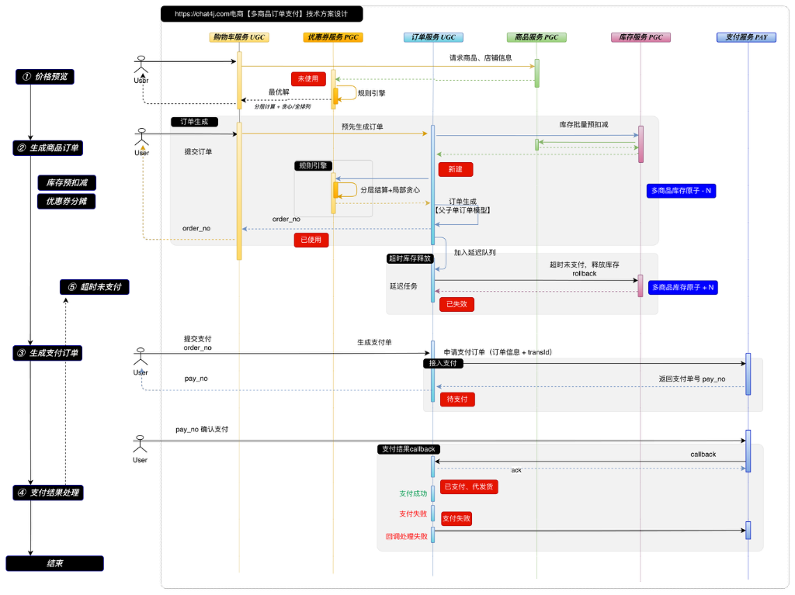
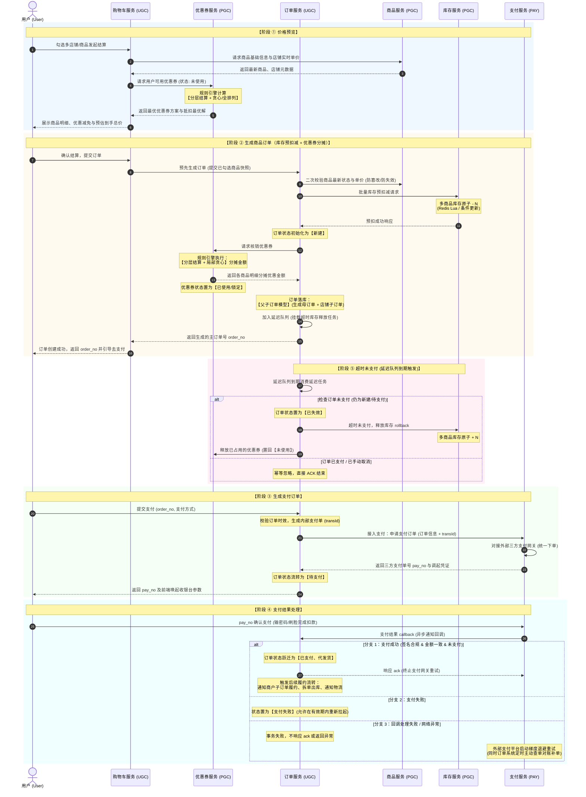
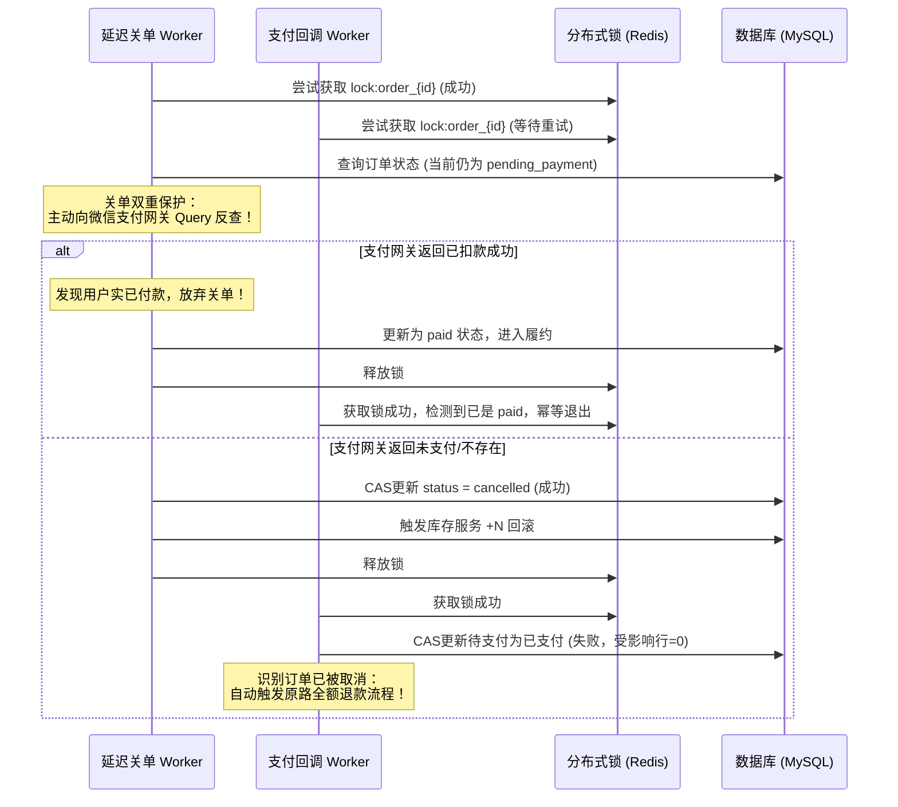

# 电商系统【多商品订单支付】技术方案设计

在多商户平台型电商（如京东、淘宝、拼多多等）业务场景中，用户购物车常包含多个店铺（跨商家）的多个商品（SKU）。用户合并下单并一次性完成支付，涉及**价格实时预览计算**、**跨店优惠券分摊**、**多商品并发库存原子预扣**、**父子订单拆单履约**、**支付网关集成与异步回调幂等**以及**超时未支付自动关单与库存回滚**等关键环节。

本文基于实际生产级微服务/模块化架构，对多商品订单支付全链路进行完整技术方案拆解与工程落地指导。

::: tip 方案架构图
本技术方案对应的系统时序设计全景如下：


:::

---

## 一、系统角色与服务职责划分（UGC vs PGC）

在电商系统架构中，根据数据来源与读写特性的不同，系统通常划分为 **UGC（面向用户产生高频动态数据）** 与 **PGC（平台/商家权威主数据）** 两大体系。明确服务边界有助于针对性地做缓存隔离、并发控制与容灾降级：

| 服务名称 | 属性定位 | 核心职责说明 | 数据特征与一致性要求 |
| --- | --- | --- | --- |
| **购物车服务 (Cart Service)** | **UGC** | 负责用户加购、勾选、临时改数、聚合购物车商品并触发预结算。 | 高并发读写、允许最终一致、客户端弱绑定。 |
| **优惠券服务 (Coupon Service)** | **PGC** | 维护平台券、店铺券、品类券的领取状态与核销规则；运行促销规则引擎计算最优解与分摊金额。 | 强一致性、资损敏感；防刷券、防重复核销、需严格回滚。 |
| **订单服务 (Order Service)** | **UGC** | 订单全流程编排器。负责生成父子订单、驱动订单状态机、投递超时延迟队列、协调支付与下游履约。 | 业务主干服务；核心数据要求强一致与事务完整性。 |
| **商品服务 (Product Service)** | **PGC** | 提供 SPU/SKU 元数据、权威单价、店铺归属、上下架状态与限购策略。 | 读多写少、重缓存、严禁前端传价，以下单时刻权威数据为准。 |
| **库存服务 (Stock Service)** | **PGC** | 管理 SKU 的物理库存与可售库存，支持多商品原子预占（-N）与取消回滚（+N）。 | 极高并发下的强一致性；严禁超卖、少卖，杜绝脏读与负库存。 |
| **支付服务 (Payment Gateway)** | **PAY** | 统一封装微信支付、支付宝、银联等三方网关；维护支付单、拉起支付凭证并分发异步支付回调。 | 资金安全级保障；全链路防篡改、强签名校验、幂等防重。 |

---

## 二、端到端完整时序图

整个技术链路涵盖 5 个核心阶段：**① 价格预览** $\to$ **② 生成商品订单** $\to$ **③ 生成支付订单** $\to$ **④ 支付结果处理**，并在第二阶段并行挂载 **⑤ 超时未支付** 兜底释放机制。



---

## 三、各阶段详细技术方案设计

### 3.1 阶段 ①：价格预览 (Price Preview)

用户在购物车勾选不同店铺的多款商品后，系统需要以高吞吐、低延迟的方式计算并展示明细与优惠：

1. **商品与店铺权威元数据获取**：
   - 购物车服务不相信客户端传入的单价，仅接收 `sku_id` 与 `quantity`。
   - 向商品服务批量查询 SKU 最新售价、店铺信息、运费模板及上下架状态。商品信息多由 Redis 缓存加速读取。
2. **优惠券规则引擎计算（分层结算 + 贪心/全排列）**：
   - 用户账户中拥有的券状态均为 `未使用`。
   - **分层计算模型**：电商促销通常按层级互斥与叠加，常见层级自底向上为：
     $$\text{商品级单品立减} \to \text{店铺级满减/满折券} \to \text{跨店铺品类满减券} \to \text{全平台通用券} \to \text{红包/积分抵扣}$$
   - **求解策略（贪心 vs 全排列）**：
     - 若同层可用券量较小（如 $\le 5$ 张），采用**全排列（穷举搜索）**，遍历计算减免金额最大的券组合，获得全局最优解。
     - 若可用券量庞大，为防止算法复杂度爆炸导致接口超时，系统采用**贪心策略 + 剪枝优化**：按券面额比例优先、高门槛优先、临期优先进行排序匹配，选取局部最优解。
3. **返回前端预览**：
   - 返回商品原始总金额、各级预估优惠总额、各店铺应付小计以及最终预估实付金额。

---

### 3.2 阶段 ②：生成商品订单 (Generate Order)

此阶段是电商最核心的交易落单节点，必须严格保证**防超卖**与**资金分摊不变量**：

#### 1. 防重复提交与订单预建
客户端提交订单时必须附带结算页生成的唯一的 `Submit-Token`（或防重幂等键）。通过 Redis 执行 `SET submit_token_{uuid} 1 NX EX 30` 拦截重复点击。

#### 2. 多商品库存批量原子预扣减（多商品库存原子 - N）
用户一次购买跨店铺的多件商品，涉及多个独立的 SKU 库存。若逐个扣减，一旦中途某个 SKU 库存不足，会面临前置已扣库存补偿失败的风险：

- **方案选型：Redis + Lua 脚本原子批量扣减**
  在 Redis 中维护各 SKU 的可用库存，将多个 `sku_id` 和对应 `buy_num` 打包传入 Lua 脚本。Lua 保证脚本在 Redis 单线程执行过程中的**原子性**：
  - 脚本第一阶段：遍历所有 SKU，若发现任意一个 SKU 的 `current_stock < buy_num`，则直接中断并返回库存不足的 SKU 标识，**不改变任何库存**。
  - 脚本第二阶段：若全部 SKU 库存充足，统一执行 `DECRBY` 扣减，并记录预占缓存。
- 随后异步发送库存预占消息，或在数据库事务内按**固定排序规则（如升序按 sku_id 加锁）**更新数据库，避免高并发下并发事务循环等待导致 MySQL 死锁。

#### 3. 优惠券规则引擎执行（分层结算 + 局部贪心分摊）
选定优惠券后，不能简单地从总金额中扣除，必须将优惠券金额精确分摊到每个具体的商品明细行（`order_items`）：
- **分摊算法公式**：
  设跨店铺满减券面额为 $C$，参与凑单的商品集总售价为 $S_{\text{total}} = \sum_{i=1}^n P_i$。
  第 $i$ 个商品的理论分摊优惠金额为：
  $$D_i = \left\lfloor C \times \frac{P_i}{S_{\text{total}}} \right\rfloor$$
- **消灭最后一分钱误差（尾差平摊）**：
  由于计算机浮点舍入或整除向下取整，前 $n-1$ 个商品的累积优惠之和 $\sum_{i=1}^{n-1} D_i$ 可能小于券面额 $C$。
  将最后一个商品的分摊金额直接定为差额：
  $$D_n = C - \sum_{i=1}^{n-1} D_i$$
  从而严格保证：
  $$\sum_{i=1}^n D_i = C$$
  杜绝部分退款时累计退款金额超过实付金额的资损隐患。
- 优惠券状态同步原子更新为 `已使用（已锁定）`。

#### 4. 父子订单模型（Parent-Child Order Model）
落库时必须创建**父子两级订单结构**：
- **母订单（Parent Order / 订单总单）**：
  - 代表用户本次支付的唯一结算主体。
  - 维护用户 ID、全局总原价、全局总优惠、总实付金额、支付倒计时等。
  - 对应支付网关的一笔交易，负责收银台合并扣款。
- **子订单（Sub Order / 店铺商户单）**：
  - 按商家店铺（Shop/Merchant ID）切分拆单。
  - 每个子订单包含该商家名下的商品明细行（`order_items`）。
  - 代表独立的履约单元，每个子订单有独立的履约状态、物流单号、对账结算逻辑与售后退款通道。
- **金额守恒约束**：
  $$\text{母订单实付金额} = \sum \text{子订单实付金额} = \sum \text{商品明细实际支付金额} + \sum \text{运费}$$

#### 5. 挂载超时库存释放（延迟队列）
订单落库成功且状态初始化为 `新建（New）` 后，订单服务向延迟队列（如 RabbitMQ TTL + 死信队列、RocketMQ 延迟消息或 Redis 延迟队列）投递一条消息：
- 携带载荷：`{ "order_no": "...", "create_time": 1795259543 }`
- 延迟时长：例如 15 分钟（业务允许的最大未支付保留期）。

---

### 3.3 阶段 ⑤：超时未支付控制 (Timeout Stock Release)

用户若由于犹豫、余额不足或网络故障未在规定时限内支付，系统必须能够自动闭环：

```text
[延迟队列到期] 
      │
      ▼
[订单服务消费] ── (双重检查 DB 订单状态)
      ├── 已支付 / 已处理 ───────────────► [幂等忽略，直接 ACK]
      └── 仍为新建 / 待支付
            │
            ▼
      [更新订单状态为【已失效】]
            │
            ├─► 调用库存服务 PGC ────► 【多商品库存原子 + N】 (回滚恢复库存)
            └─► 调用优惠券服务 PGC ──► 【释放优惠券】 (恢复状态为“未使用”)
```

::: warning 超时关单与支付并发竞争（AB 竞争）
极端场景下，**用户在第 14 分 59 秒在外部渠道付款完成，而延迟任务恰好在第 15 分 00 秒到期执行关单**。
- **防护方案**：
  1. 执行关单前，先通过分布式锁锁定母订单 `lock:order_{order_no}`。
  2. 关单前先向支付服务反查（Query Payment Gateway）第三方渠道该订单的真实支付状态。
  3. 若支付渠道显示已扣款，则放弃关单，立刻走支付成功履约补单流程。
  4. 数据库状态流转采用条件更新（CAS）：
     ```sql
     UPDATE orders SET status = 'cancelled', cancel_reason = 'timeout' 
     WHERE order_no = :order_no AND status IN ('new', 'pending_payment');
     ```
     若影响行数为 0，说明状态已被支付回调修改，关单逻辑退出，禁止释放库存。
:::

---

### 3.4 阶段 ③：生成支付订单 (Generate Payment Order)

当用户在收银台选择支付方式（如微信支付、支付宝）并确认发起付款：

1. **订单前置校验**：
   - 校验母订单是否存在、状态是否为 `新建` 或 `待支付`、是否已超时失效。
2. **生成内部支付流水单（Payment Transaction）**：
   - 支付流水单与业务订单解耦，生成唯一的商户交易凭据 `transId`（例如 `PAY_20261121_xxxx`）。
   - 一笔订单可能因为用户首次支付余额不足或切换支付方式而产生多次发起动作，一个 `order_no` 可以对应多笔 `transId`，但同一时间仅有一笔有效。
3. **支付网关统一下单**：
   - 订单服务向支付服务发起 `申请支付订单（订单信息 + transId）`。
   - 支付服务组装商户私钥签名，调用微信/支付宝统一下单 API。
   - 外部支付网关受理并返回三方支付流水号 `pay_no`（如微信支付的 `prepay_id`）。
4. **状态跃迁与客户端唤起**：
   - 订单服务更新母订单状态为【`待支付`】，绑定当前生效的 `pay_no` 与 `transId`。
   - 向客户端返回拉起原生收银台或 SDK 所需的加密验签参数（`appId`, `timeStamp`, `nonceStr`, `package`, `paySign` 等）。

---

### 3.5 阶段 ④：支付结果处理 (Payment Result Handling)

用户在支付收银台完成鉴权扣款后，支付服务接收外部渠道异步回调并推进订单状态：

#### 1. 回调安全与数据合规校验
- **验签**：使用三方支付平台公钥对回调报文做验签，严防伪造回调。
- **幂等防重**：支付渠道可能因未及时收到商户 ACK 而重复推送（通常按 $15s, 15s, 30s, 3m, 10m \dots$ 阶梯重试）。通过在支付流水表增加 `UNIQUE KEY (pay_no)` 或通过分布式锁保证同一次回调仅被执行一次。
- **金额对账防篡改**：
  ```php
  // 必须严格使用整数（分）比对实付金额与母订单应付金额
  if ((int)$callback['total_fee'] !== (int)$order['pay_amount']) {
      // 触发重大安全风险告警，人工介入排查，严禁推进订单状态！
      Log::critical("支付金额篡改风险! 回调: {$callback['total_fee']}, 订单: {$order['pay_amount']}");
      return response('FAIL', 400);
  }
  ```

#### 2. 三大处理分支

- **分支 1【支付成功】**：
  - 更新支付流水表状态为 `SUCCESS`，记录三方交易号、交易完成时间。
  - 订单状态机通过 CAS 跃迁：
    $$\text{待支付 (pending\_payment)} \longrightarrow \text{已支付、代发货 (paid\_waiting\_delivery)}$$
  - 母订单更新完成后，批量更新旗下所有子订单状态为 `已支付`。
  - 立即向支付网关响应 `ack`（如输出 `<xml><return_code>SUCCESS</return_code></xml>` 或 JSON `code: SUCCESS`）。
  - **触发异步履约驱动**：投递事务消息或领域事件（`OrderPaidEvent`），通知各商户 WMS 仓储系统开始打单拣货、锁定真正物理库存、通知物流、增加用户积分等。
- **分支 2【支付失败】**：
  - 回调明确通知扣款失败（如银行卡限额、风控拦截等）。
  - 记录流水日志，更新支付状态为 `FAILED`，母订单保留在 `待支付` 或标记 `支付失败`，允许用户在失效前更换支付渠道再次支付。
- **分支 3【回调处理失败 / 系统异常】**：
  - 若系统在更新订单、落库或发事件时发生异常（如 DB 宕机、死锁），必须回滚本地事务，**严禁响应 ack**。
  - 依赖三方支付渠道的重试机制发起重新通知。
  - **兜底保障机制**：系统常驻“主动查单对账任务”，定时拉取创建超过 3 分钟但处于 `待支付` 的订单，主动调用微信/支付宝订单查询接口（Query Order API），实现掉单自动补录。

---

## 四、核心数据模型与表结构设计 (MySQL 8.x)

为支撑父子订单架构、精准分摊、并发库存防超卖与支付流水追踪，核心 DDL 设计如下：

```sql
-- 1. 母订单表（结算主体）
CREATE TABLE `orders` (
    `id` BIGINT UNSIGNED NOT NULL AUTO_INCREMENT COMMENT '主键ID',
    `order_no` VARCHAR(64) NOT NULL COMMENT '业务母订单号 (全局唯一)',
    `user_id` BIGINT UNSIGNED NOT NULL COMMENT '下单用户ID',
    `total_amount` INT NOT NULL COMMENT '订单商品总原价 (单位: 分)',
    `discount_amount` INT NOT NULL DEFAULT 0 COMMENT '总优惠抵扣金额 (单位: 分)',
    `freight_amount` INT NOT NULL DEFAULT 0 COMMENT '总运费 (单位: 分)',
    `pay_amount` INT NOT NULL COMMENT '用户实际应付金额 (单位: 分)',
    `status` VARCHAR(32) NOT NULL DEFAULT 'new' COMMENT '状态: new新建, pending_payment待支付, paid已支付, cancelled已失效, closed已关闭',
    `expire_time` DATETIME NOT NULL COMMENT '支付超时截止时间',
    `paid_at` DATETIME DEFAULT NULL COMMENT '支付完成时间',
    `created_at` DATETIME NOT NULL DEFAULT CURRENT_TIMESTAMP,
    `updated_at` DATETIME NOT NULL DEFAULT CURRENT_TIMESTAMP ON UPDATE CURRENT_TIMESTAMP,
    PRIMARY KEY (`id`),
    UNIQUE KEY `uk_order_no` (`order_no`),
    KEY `idx_user_status` (`user_id`, `status`),
    KEY `idx_expire_status` (`expire_time`, `status`)
) ENGINE=InnoDB DEFAULT CHARSET=utf8mb4 COMMENT='母订单表(支付合并单)';

-- 2. 子订单表（商户履约主体）
CREATE TABLE `sub_orders` (
    `id` BIGINT UNSIGNED NOT NULL AUTO_INCREMENT COMMENT '子订单ID',
    `sub_order_no` VARCHAR(64) NOT NULL COMMENT '子订单号 (全局唯一)',
    `order_no` VARCHAR(64) NOT NULL COMMENT '关联母订单号',
    `shop_id` BIGINT UNSIGNED NOT NULL COMMENT '店铺商户ID',
    `total_amount` INT NOT NULL COMMENT '店铺内商品原价总计 (单位: 分)',
    `discount_amount` INT NOT NULL DEFAULT 0 COMMENT '分摊到本子订单的优惠额 (单位: 分)',
    `pay_amount` INT NOT NULL COMMENT '店铺实付金额 (结算对账基准, 单位: 分)',
    `status` VARCHAR(32) NOT NULL DEFAULT 'new' COMMENT '状态: new新建, paid待发货, shipped已发货, finished已完成, refunding退款中',
    `created_at` DATETIME NOT NULL DEFAULT CURRENT_TIMESTAMP,
    `updated_at` DATETIME NOT NULL DEFAULT CURRENT_TIMESTAMP ON UPDATE CURRENT_TIMESTAMP,
    PRIMARY KEY (`id`),
    UNIQUE KEY `uk_sub_order_no` (`sub_order_no`),
    KEY `idx_order_no` (`order_no`),
    KEY `idx_shop_status` (`shop_id`, `status`)
) ENGINE=InnoDB DEFAULT CHARSET=utf8mb4 COMMENT='商户子订单表(履约拆单)';

-- 3. 订单商品明细表（含精确优惠分摊）
CREATE TABLE `order_items` (
    `id` BIGINT UNSIGNED NOT NULL AUTO_INCREMENT COMMENT '明细行ID',
    `sub_order_no` VARCHAR(64) NOT NULL COMMENT '关联子订单号',
    `order_no` VARCHAR(64) NOT NULL COMMENT '关联母订单号',
    `sku_id` BIGINT UNSIGNED NOT NULL COMMENT '商品SKU_ID',
    `sku_name` VARCHAR(255) NOT NULL COMMENT '商品名称',
    `price` INT NOT NULL COMMENT '销售单价 (单位: 分)',
    `quantity` INT NOT NULL COMMENT '购买数量',
    `total_amount` INT NOT NULL COMMENT '行小计 = price * quantity',
    `discount_share_amount` INT NOT NULL DEFAULT 0 COMMENT '分摊到本商品行的总优惠金额 (单位: 分)',
    `real_pay_amount` INT NOT NULL COMMENT '实际支付金额 = total_amount - discount_share_amount',
    `created_at` DATETIME NOT NULL DEFAULT CURRENT_TIMESTAMP,
    PRIMARY KEY (`id`),
    KEY `idx_sub_order_no` (`sub_order_no`),
    KEY `idx_order_no` (`order_no`)
) ENGINE=InnoDB DEFAULT CHARSET=utf8mb4 COMMENT='订单商品行明细表';

-- 4. 支付交易流水表
CREATE TABLE `payment_transactions` (
    `id` BIGINT UNSIGNED NOT NULL AUTO_INCREMENT COMMENT '流水ID',
    `trans_id` VARCHAR(64) NOT NULL COMMENT '内部商户交易流水号',
    `order_no` VARCHAR(64) NOT NULL COMMENT '业务母订单号',
    `pay_channel` VARCHAR(32) NOT NULL COMMENT '支付渠道: wechat, alipay, unionpay',
    `pay_no` VARCHAR(128) DEFAULT NULL COMMENT '第三方支付网关流水号',
    `amount` INT NOT NULL COMMENT '交易发起金额 (单位: 分)',
    `status` VARCHAR(32) NOT NULL DEFAULT 'pending' COMMENT '状态: pending支付中, success成功, failed失败',
    `raw_callback_payload` JSON DEFAULT NULL COMMENT '支付网关原始回调报文备份',
    `paid_at` DATETIME DEFAULT NULL COMMENT '三方支付时间',
    `created_at` DATETIME NOT NULL DEFAULT CURRENT_TIMESTAMP,
    `updated_at` DATETIME NOT NULL DEFAULT CURRENT_TIMESTAMP ON UPDATE CURRENT_TIMESTAMP,
    PRIMARY KEY (`id`),
    UNIQUE KEY `uk_trans_id` (`trans_id`),
    UNIQUE KEY `uk_pay_no` (`pay_no`),
    KEY `idx_order_no` (`order_no`)
) ENGINE=InnoDB DEFAULT CHARSET=utf8mb4 COMMENT='支付交易流水表';

-- 5. 优惠券核销记录表
CREATE TABLE `coupon_usages` (
    `id` BIGINT UNSIGNED NOT NULL AUTO_INCREMENT,
    `coupon_id` BIGINT UNSIGNED NOT NULL COMMENT '优惠券模板ID',
    `user_coupon_id` BIGINT UNSIGNED NOT NULL COMMENT '用户领取的优惠券唯一ID',
    `order_no` VARCHAR(64) NOT NULL COMMENT '核销的母订单号',
    `discount_amount` INT NOT NULL COMMENT '抵扣总金额 (单位: 分)',
    `status` VARCHAR(32) NOT NULL DEFAULT 'locked' COMMENT '状态: locked已锁定, used已核销, released已回滚',
    `created_at` DATETIME NOT NULL DEFAULT CURRENT_TIMESTAMP,
    `updated_at` DATETIME NOT NULL DEFAULT CURRENT_TIMESTAMP ON UPDATE CURRENT_TIMESTAMP,
    PRIMARY KEY (`id`),
    UNIQUE KEY `uk_order_coupon` (`order_no`, `user_coupon_id`)
) ENGINE=InnoDB DEFAULT CHARSET=utf8mb4 COMMENT='优惠券核销记录表';
```

---

## 五、关键算法与核心代码工程示范

### 5.1 多商品库存原子批量预扣减 Lua 脚本

在 Redis 中批量预扣多个商品库存，若任一商品库存不够，则整体中断，不扣减任何库存：

```lua
-- KEYS: 无固定 KEYS，通过 ARGV 传入 JSON 格式或平铺参数
-- 参数格式: ARGV[1] = 商品数量 N
-- 随后依次为: sku_id_1, buy_num_1, sku_id_2, buy_num_2, ...

local count = tonumber(ARGV[1])
local sku_keys = {}
local buy_nums = {}

-- 1. 第一阶段：前置校验所有 SKU 库存是否充足
for i = 1, count do
    local sku_id = ARGV[2 * i]
    local buy_num = tonumber(ARGV[2 * i + 1])
    local stock_key = "stock:sku:" .. sku_id
    
    local curr_stock = tonumber(redis.call('GET', stock_key) or "-1")
    if curr_stock < buy_num then
        -- 发现库存不足，返回失败及缺货的 sku_id，彻底中断
        return { 0, sku_id, curr_stock, buy_num }
    end
    
    table.insert(sku_keys, stock_key)
    table.insert(buy_nums, buy_num)
end

-- 2. 第二阶段：若全部满足，统一执行原子批量扣减
for i = 1, count do
    redis.call('DECRBY', sku_keys[i], buy_nums[i])
end

return { 1, "SUCCESS" }
```

### 5.2 优惠券分摊算法（分层结算 + 局部贪心 + 消除最后一分钱误差）

在 PHP (Laravel) 中安全处理分币计算，杜绝浮点数与四舍五入丢钱：

```php
<?php

namespace App\Services\Order;

class CouponSplitter
{
    /**
     * 将优惠券总额精确分摊到各商品明细
     *
     * @param int $totalCouponDiscount 优惠券总面额（单位：分）
     * @param array $items 商品列表 [['sku_id' => 101, 'item_amount' => 5000], ...]
     * @return array 分摊后的商品数组，追加 'discount_share' 与 'real_pay'
     */
    public static function split(int $totalCouponDiscount, array $items): array
    {
        $totalItemsAmount = array_sum(array_column($items, 'item_amount'));
        
        // 若商品总额小于等于优惠面额，全部减免至0元（保留最低支付1分钱规则视业务而定）
        if ($totalItemsAmount <= $totalCouponDiscount) {
            foreach ($items as &$item) {
                $item['discount_share'] = $item['item_amount'];
                $item['real_pay'] = 0;
            }
            return $items;
        }

        $allocatedDiscount = 0;
        $count = count($items);

        for ($i = 0; $i < $count; $i++) {
            if ($i === $count - 1) {
                // 最后一个商品吸收所有尾差，确保 sum(discount_share) === totalCouponDiscount
                $itemDiscount = $totalCouponDiscount - $allocatedDiscount;
            } else {
                // 向下取整计算当前商品应分摊的分数
                $itemDiscount = (int) floor(($totalCouponDiscount * $items[$i]['item_amount']) / $totalItemsAmount);
                $allocatedDiscount += $itemDiscount;
            }

            $items[$i]['discount_share'] = $itemDiscount;
            $items[$i]['real_pay'] = $items[$i]['item_amount'] - $itemDiscount;
        }

        return $items;
    }
}
```

### 5.3 支付回调处理与状态机跃迁 (Laravel 示例)

```php
<?php

namespace App\Http\Controllers;

use Illuminate\Http\Request;
use Illuminate\Support\Facades\DB;
use Illuminate\Support\Facades\Log;
use App\Models\Order;
use App\Models\PaymentTransaction;
use App\Events\OrderPaidEvent;

class PaymentCallbackController extends Controller
{
    public function handleWechatNotify(Request $request)
    {
        // 1. 签名与渠道鉴权校验
        $payload = $this->verifyWechatSignature($request);
        if (!$payload) {
            return response('<xml><return_code>FAIL</return_code></xml>', 400);
        }

        $orderNo   = $payload['out_trade_no'];
        $payNo     = $payload['transaction_id'];
        $paidTotal = (int) $payload['total_fee']; // 单位: 分

        // 2. 加分布式锁防止并发重复回调
        $lockKey = "lock:pay_notify:{$orderNo}";
        return cache()->lock($lockKey, 10)->get(function () use ($orderNo, $payNo, $paidTotal, $payload) {
            return DB::transaction(function () use ($orderNo, $payNo, $paidTotal, $payload) {
                // 3. 锁定查询母订单与支付单
                $order = Order::where('order_no', $orderNo)->lockForUpdate()->first();
                if (!$order) {
                    Log::error("支付回调订单不存在: {$orderNo}");
                    return response('FAIL', 404);
                }

                // 幂等检查：若已支付，直接响应成功
                if ($order->status === 'paid') {
                    return response('<xml><return_code>SUCCESS</return_code></xml>', 200);
                }

                // 4. 严谨核对实付金额
                if ($order->pay_amount !== $paidTotal) {
                    Log::critical("金额篡改拦截! 订单: {$order->pay_amount}, 实际支付: {$paidTotal}");
                    return response('FAIL', 400);
                }

                // 5. 状态跃迁：母订单与子订单批量推进为 paid
                $order->update([
                    'status'  => 'paid',
                    'paid_at' => now(),
                ]);

                DB::table('sub_orders')->where('order_no', $orderNo)->update([
                    'status'     => 'paid',
                    'updated_at' => now(),
                ]);

                // 6. 更新支付流水表
                PaymentTransaction::where('order_no', $orderNo)
                    ->where('status', 'pending')
                    ->update([
                        'pay_no'               => $payNo,
                        'status'               => 'success',
                        'raw_callback_payload' => json_encode($payload),
                        'paid_at'              => now(),
                    ]);

                // 7. 发送已支付领域事件 (异步触发仓储拣货、发票、积分等)
                event(new OrderPaidEvent($order->order_no));

                return response('<xml><return_code>SUCCESS</return_code></xml>', 200);
            });
        });
    }
}
```

---

## 六、并发、异常与资损防护算例推演

### 算例 1：跨店多商品优惠券分摊与金额守恒检验

**业务场景**：
用户在店铺 A 购买商品 1（售价 39.00 元 = 3900 分），在店铺 B 购买商品 2（售价 29.90 元 = 2990 分），在店铺 B 购买商品 3（售价 31.10 元 = 3110 分）。总计原价 100.00 元（10000 分）。
用户使用一张平台“满 100 减 15 元”的通用券（券面额 1500 分），运费为 0。

- **不变量检验 1（总额守恒）**：所有明细的实付金额之和必须完全等于用户最终银行卡扣款金额（8500 分）。
- **计算过程推演**：
  1. 商品 1（原价 3900 分）：
     $$\text{理论优惠} = \lfloor 1500 \times \frac{3900}{10000} \rfloor = \lfloor 585 \rfloor = 585 \text{分}$$
     商品 1 实付 $= 3900 - 585 = 3315$ 分。已分配优惠累积 $= 585$ 分。
  2. 商品 2（原价 2990 分）：
     $$\text{理论优惠} = \lfloor 1500 \times \frac{2990}{10000} \rfloor = \lfloor 448.5 \rfloor = 448 \text{分}$$
     商品 2 实付 $= 2990 - 448 = 2542$ 分。已分配优惠累积 $= 585 + 448 = 1033$ 分。
  3. 商品 3（原价 3110 分，作为最后一件商品吸收尾差）：
     $$\text{吸收尾差优惠} = 1500 - 1033 = 467 \text{分}$$
     商品 3 实付 $= 3110 - 467 = 2643$ 分。
- **验证结果**：
  - 分摊优惠合计：$585 + 448 + 467 = 1500$ 分（与券面额完全一致，无丢分）。
  - 实付总额合计：$3315 + 2542 + 2643 = 8500$ 分（与母订单应付 $10000 - 1500 = 8500$ 分严格相等）。
  - 若用户后续申请退款商品 2，系统精准退还其实付金额 25.42 元，商家和平台各自分摊明确，无任何财务对账坏账。

---

### 算例 2：高并发秒杀场景下的库存原子扣减

**高并发场景**：
某爆款 SKU 仅剩 2 件库存，同时有请求 A（欲购买 2 件）和请求 B（欲购买 1 件）在同一毫秒级并发到达。

| 步骤 | 请求 A (购买 2 件) | 请求 B (购买 1 件) | 观察与底层机制 |
| --- | --- | --- | --- |
| 1 | 进入 Redis Lua 脚本原子评估 | 排队等待 Redis 单线程执行 | Redis 执行单线程原子调度 |
| 2 | 读取库存为 2，满足 $\ge 2$，执行 `DECRBY 2`，剩余 0 | 等待进入 | 状态原子更新，无任何中间态泄露 |
| 3 | Lua 脚本返回成功，进入后续订单创建 | 开始执行 Lua 脚本，读到当前库存为 0 | 读到最新状态为 0，小于所求 1 件 |
| 4 | 成功生成订单，进入待支付 | Lua 脚本立刻返回库存不足，拒绝下单 | **安全拦截，彻底杜绝负库存与超卖** |

---

### 算例 3：超时未支付与支付回调并发到达竞争

**极端边界条件**：
延迟队列在 $T = 15\text{min } 00.000\text{s}$ 到达，订单服务启动超时关单逻辑；
微信支付异步回调在 $T = 15\text{min } 00.050\text{s}$ 到达，通知该订单支付成功。



---

## 七、关键术语与高频设计考点

| 关键术语 | 架构设计解释 | 面试与实战避坑要点 |
| --- | --- | --- |
| **UGC / PGC** | UGC 指用户高频动态生成的数据（购物车、订单）；PGC 指后台/商家发布的主数据（商品、库存、活动）。 | 严禁让 UGC 服务持有或直接相信客户端价格；计算以 PGC 权威数据为基准。 |
| **父子订单模型 (Parent-Child Orders)** | 母订单面向支付收银台，实现一次性合并支付；子订单面向商户门店，实现解耦履约、发货与部分退款。 | 必须保证母订单应付等于各子订单实付之和，退款时仅操作子订单及其商品行。 |
| **局部贪心分摊** | 跨店优惠按商品金额权重分摊，最后一行商品吸收除不尽的零头尾差。 | 避免浮点数精度丢失，必须统一采用“分”为整数存储与计算。 |
| **原子预扣减 (-N)** | 在订单创建时刻冻结或预扣库存，支付成功真正出库，超时未支付则释放 (+N)。 | 单个 SQL 或 Redis Lua 中完成多个 SKU 判断与扣除，避免部分成功导致的不一致。 |
| **延迟队列 (Delay Queue)** | 在指定未来时间点触发超时未支付的关单检查。 | 延迟消费必须先做状态幂等校验（Check-Then-Act），防止关掉已付款订单。 |
| **支付回调幂等** | 保证无论外部渠道由于重试推送多少次回调，系统只产生一次扣款成功和状态流转效果。 | 结合分布式锁 + 数据库 CAS 条件更新 + 支付单号唯一索引三重防护。 |

---

## 八、延伸阅读与参考

- [上一篇：测试、上线与需求协作（151—180）](./delivery-troubleshooting-interview.md)
- [MySQL、并发与报表](./mysql-concurrency-interview.md)
- [系统集成与接口设计](../advanced/system-integration-api.md)
- [返回 PHP/Laravel 面试指南](../index.md)
